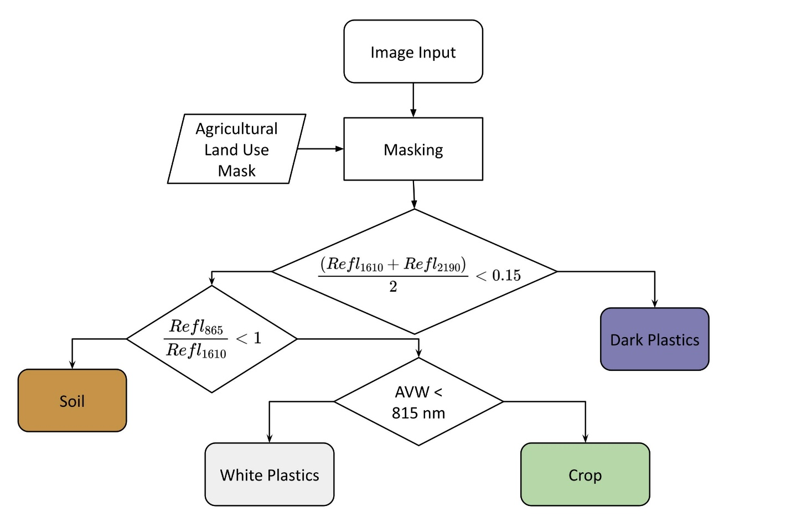
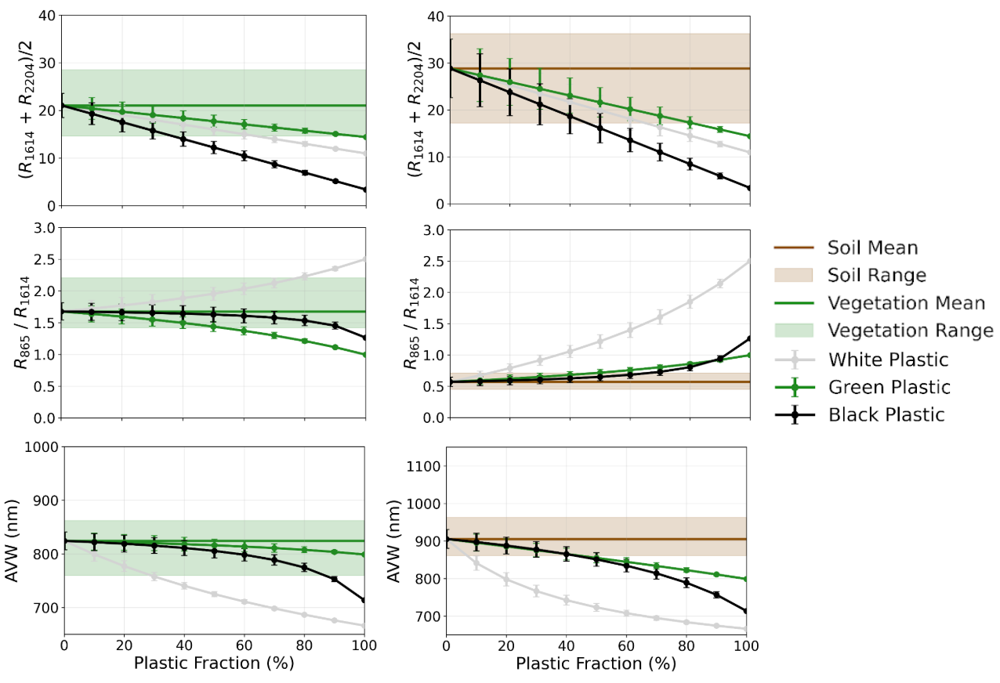

# Scrivner et al. - Remote Sensing of Plastics {.smaller}

```{=html}
<style>
.reveal .workflow-stack {
  position: relative;
  width: 100%;
  min-height: 58vh;
}

.reveal .workflow-stack > .absolute {
  inset: 0;
  width: 100%;
  box-sizing: border-box;
}

.reveal .workflow-text-stack > .absolute {
  text-align: left;
}

.reveal .workflow-image-stack > .absolute img {
  display: block;
  max-width: 100%;
  max-height: 58vh;
  margin: 0 auto;
  object-fit: contain;
}
</style>
```


## Workflow {style="font-size:0.7em"}

::: {.columns}

::: {.column width="52%"}

::: {.r-stack .workflow-stack .workflow-text-stack}

::: {.fragment .absolute .fade-out data-fragment-index="1"}

+ Get Sentinel-2 (from Copernicus in the authors' case).

:::

::: {.fragment .absolute .fade-in-then-out data-fragment-index="1"}

+ Resample and align the required bands to a common 10 m grid using bilinear interpolation.

:::

::: {.fragment .absolute .fade-in-then-out data-fragment-index="2"}

+ Erode (negative buffer) DWR crop-mapping layer polygons by 10 m to reduce edge effects.

:::

::: {.fragment .absolute .fade-in-then-out data-fragment-index="3"}

+ Mask non-agricultural areas using the California DWR crop-mapping layer.


:::

::: {.fragment .absolute .fade-in-then-out data-fragment-index="4"}

+ Identify dark plastic using mean SWIR-1 and SWIR-2 reflectance (B11 and B12):

$$
\frac{B11 + B12}{2} < 0.15
$$

:::

::: {.fragment .absolute .fade-in-then-out data-fragment-index="5"}

+ Separate bare soil from the remaining crop and bright-plastic pixels using the 865–1610 nm spectral slope:

$$
\frac{B8A}{B11} < 1
$$

:::

::: {.fragment .absolute .fade-in-then-out data-fragment-index="6"}

+ Distinguish white or bright plastic from crop using AVW:

$$
AVW < 815\ \mathrm{nm}
$$

:::

::: {.fragment .absolute .fade-in-then-out data-fragment-index="7"}

+ Classify the remaining pixels as crop.

:::

::: {.fragment .absolute .fade-in-then-out data-fragment-index="8"}

+ More succinctly:

```text
IF mean(B11, B12) < 0.15: dark plastic
ELSE IF B8A / B11 < 1:    soil
ELSE IF AVW < 815 nm:     white/bright plastic
ELSE:                     crop
```

:::

::: {.fragment .absolute .fade-in-then-out data-fragment-index="9"}

+ The authors trained RF and RBF-SVM classifiers for comparison. You do not need to do this, unless you have lot's of time on your hands.

:::

:::

:::

::: {.column width="48%"}

::: {.r-stack .workflow-stack .workflow-image-stack}

::: {.fragment .absolute .fade-out data-fragment-index="1"}

{fig-alt="Decision tree used to classify dark plastic, soil, white plastic, and crop from Sentinel-2 imagery"}

:::

::: {.fragment .absolute .fade-in-then-out data-fragment-index="1"}

{fig-alt="Decision tree used to classify dark plastic, soil, white plastic, and crop from Sentinel-2 imagery"}

:::

::: {.fragment .absolute .fade-in-then-out data-fragment-index="2"}

:::{style="font-size:0.5em"}
The polygons came from the California Department of Water Resources’ **Statewide Crop Mapping** program. The authors appear to have used the [`i15_Crop_Mapping_2021_Provisional.shp`](https://lab.data.ca.gov/dataset/statewide-crop-mapping "California DWR 2021 Statewide Crop Mapping GIS shapefile") layer, produced by Land IQ under contract to DWR.

The manuscript is ambiguous about the exact dataset version. It cites the dataset as “California DWR, 2024,” refers elsewhere to a “2021 California Statewide Mapping GIS Shapefile,” and does not provide the downloaded filename or indicate whether the provisional or final 2021 release was used. 

For this project, you do not need to use the 2021 layer specifically. You may select another available crop-layer year(s) and Sentinel-2 or reference imagery from a corresponding period. You should record the layer year, release status, imagery dates, and any temporal mismatch between the crop boundaries and satellite imagery.
:::

:::

::: {.fragment .absolute .fade-in-then-out data-fragment-index="3"}

{fig-alt="Decision tree used to classify dark plastic, soil, white plastic, and crop from Sentinel-2 imagery"}

:::

::: {.fragment .absolute .fade-in-then-out data-fragment-index="4"}

{fig-alt="Figure 5 from Scrivner et al. showing mean SWIR reflectance versus plastic fraction for crop mixtures on the left and soil mixtures on the right"}

:::

::: {.fragment .absolute .fade-in-then-out data-fragment-index="5"}

{fig-alt="Figure 5 from Scrivner et al. showing the 865-to-1610-nanometer reflectance ratio versus plastic fraction for crop and soil mixtures"}

:::

::: {.fragment .absolute .fade-in-then-out data-fragment-index="6" style="font-size:0.7em"}

Apparent Visible Wavelength

+ AVW reduces the entire spectrum to a one-dimensional metric of color that is correlated to spectral shape
+ In this paper AVW is applied across visible and SWIR


$$
AVW = \frac{\sum_{i=\lambda_1}^{\lambda_{n}} R_{rs} (\lambda_{i})}{\sum_{i=\lambda_1}^{\lambda_{n}} \frac{R_{rs} (\lambda_{i})}{\lambda_{i}}}
$$

where $R_{rs}$ is remotely sensed reflectance 

:::

::: {.fragment .absolute .fade-in-then-out data-fragment-index="7"}

{fig-alt="Decision tree used to classify dark plastic, soil, white plastic, and crop from Sentinel-2 imagery"}

:::

::: {.fragment .absolute .fade-in-then-out data-fragment-index="8"}

{fig-alt="Decision tree used to classify dark plastic, soil, white plastic, and crop from Sentinel-2 imagery"}

:::

::: {.fragment .absolute .fade-in-then-out data-fragment-index="9"}

{fig-alt="Decision tree used to classify dark plastic, soil, white plastic, and crop from Sentinel-2 imagery"}

:::

:::

:::

:::

## Atmospheric correction error and noise related caveats {style="font-size:0.7em"}

::: {.fragment .fade-in-then-semi-out}

- Most classes remain separable under atmospheric noise.

:::

::: {.fragment .fade-in-then-semi-out}

- SWIR albedo is least robust:
  - Black plastic detectable above 60% coverage.
  - Green plastic requires roughly 90% coverage and good illumination.

:::

::: {.fragment .fade-in-then-semi-out}

- Soil remains distinguishable from crop and >50% white plastic.

:::

::: {.fragment .fade-in-then-semi-out}

- AVW detects white plastic above 30% coverage.

:::

::: {.fragment .fade-in-then-semi-out}

- AVW threshold differs: ~750 nm in simulations versus ~815 nm in Sentinel-2 training data.

:::
